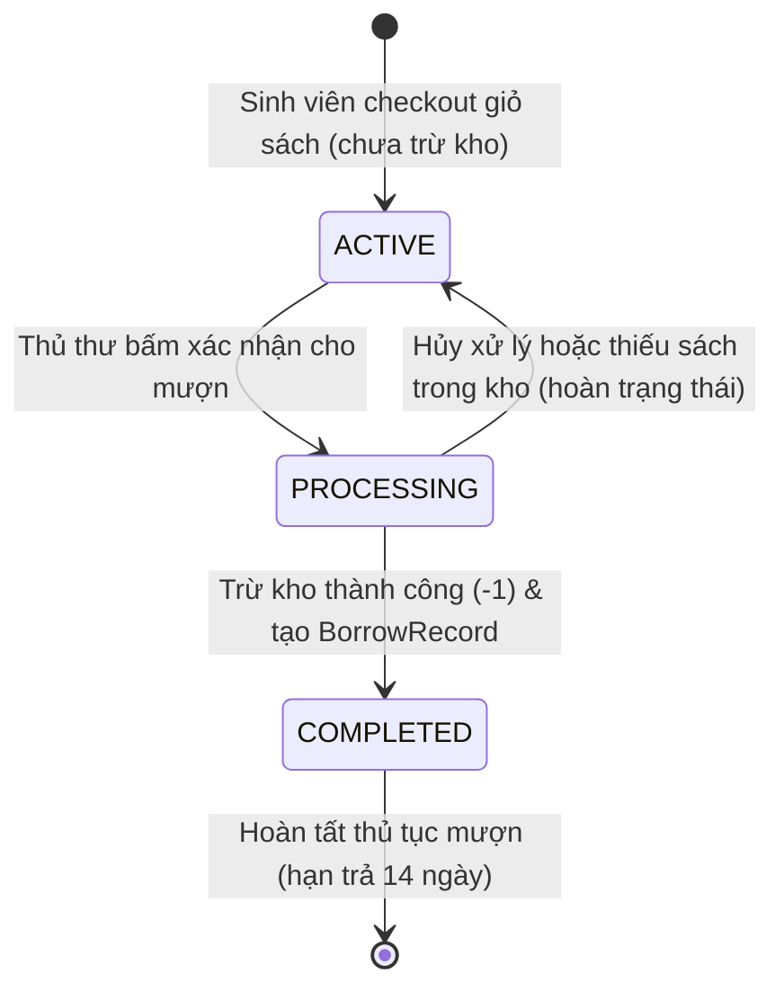
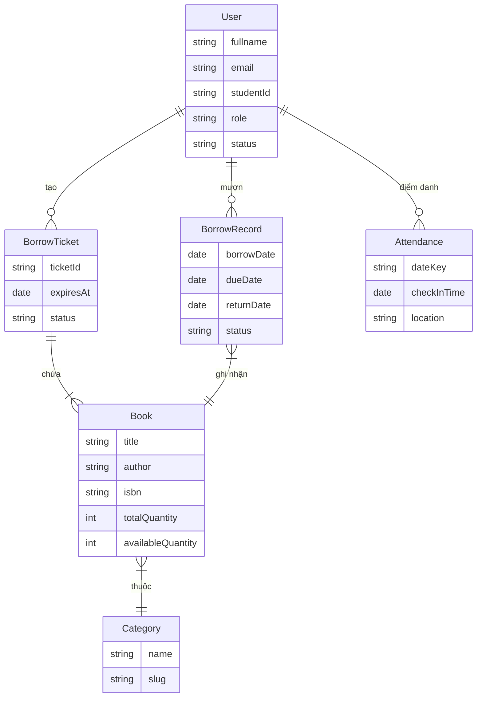

# Hệ Thống Quản Lý Thư Viện

Ứng dụng web quản lý thư viện trường học theo mô hình MVC, hỗ trợ lưu thông sách và điểm danh sinh viên. Dự án giải quyết các vấn đề sai lệch số lượng sách trong kho và giúp thủ thư vận hành mượn trả nhanh chóng qua mã QR. Hệ thống phục vụ hai nhóm người dùng chính là sinh viên và cán bộ quản trị thư viện.

---
## Điểm nổi bật
- Mượn sách bằng vé QR: Sinh viên chọn sách vào giỏ và tạo vé mượn chứa mã QR để thủ thư quét xác nhận tại quầy.
- Điểm danh mỗi ngày một lần: Hệ thống giới hạn mỗi sinh viên chỉ được điểm danh một lượt mỗi ngày theo múi giờ `Asia/Ho_Chi_Minh`.
- Phân quyền rõ ràng: Tách biệt quyền hạn giữa sinh viên và quản trị viên bằng session middleware trên server.
- Chống sai lệch tồn kho: Xử lý trừ kho và trả sách bằng các thao tác nguyên tử, ngăn chặn âm kho khi nhiều người cùng mượn cuốn sách cuối cùng.
- Công cụ quản trị: Hỗ trợ nạp và xuất dữ liệu qua tệp CSV, gửi email nhắc nhở sách quá hạn và ghi nhật ký hoạt động.

## Công nghệ sử dụng
- Nền tảng: Node.js, Express 5.
- Giao diện: Express-Handlebars, Sass.
- Cơ sở dữ liệu: MongoDB, Mongoose 9, plugin mongoose-delete.
- Xác thực & Phiên làm việc: express-session, connect-mongo (lưu session trong MongoDB), bcryptjs.
- Tiện ích: qrcode, nodemailer.
- Giới hạn tần suất: express-rate-limit.

## Tính năng chính

### Dành cho sinh viên
- Tra cứu danh mục sách theo từ khóa và thể loại.
- Thêm sách vào giỏ mượn và tạo vé mượn điện tử kèm mã QR.
- Xem vé mượn cá nhân và theo dõi lịch sử các lần mượn, trả sách.
- Quét mã điểm danh vào thư viện hàng ngày và xem lịch sử điểm danh cá nhân.
- Đổi mật khẩu.

### Dành cho quản trị viên
- Quản trị sách (thêm, sửa, ẩn sách, cập nhật số lượng tồn kho).
- Quản lý người dùng, khóa hoặc mở khóa tài khoản, tạo tài khoản lẻ hoặc nạp danh sách từ CSV.
- Quét mã QR tại quầy để đối soát vé, xác nhận cho mượn và nhận trả sách.
- Theo dõi danh sách mượn quá hạn, gửi email nhắc nhở đơn lẻ hoặc hàng loạt.
- Xuất dữ liệu sách, điểm danh, lịch sử mượn và sách quá hạn ra tệp CSV; theo dõi nhật ký hoạt động.

### Bảng phân quyền
| Khu vực / Thao tác | Khách vãng lai | Sinh viên (`role: user`) | Quản trị viên (`role: admin`) |
| :--- | :---: | :---: | :---: |
| Trang chủ (`/`), Đăng nhập (`/login`), Quên mật khẩu | Xem | Sử dụng / Chuyển hướng | Sử dụng / Chuyển hướng |
| API chi tiết sách (`/book/:_id/api`) | Xem dữ liệu JSON | Xem dữ liệu JSON | Xem dữ liệu JSON |
| Danh mục sách (`/book`), Giỏ sách & Vé QR (`/cart`) | Chuyển về `/login` | Toàn quyền | Toàn quyền |
| Xem vé mượn cá nhân (`/cart/ticket/:ticketId`) | Chuyển về `/login` | Chỉ xem vé của mình | Toàn quyền |
| Điểm danh (`/scanner`, `/attendance`), Lịch sử (`/history`) | Chuyển về `/login` | Xem dữ liệu cá nhân | Xem dữ liệu cá nhân |
| Quản trị hệ thống (`/admin/*`) | Chuyển về `/login` | Bị từ chối (403) | Toàn quyền |

## Bảo mật cơ bản
- Mật khẩu người dùng được băm an toàn bằng thư viện bcryptjs (10 vòng salt).
- Cookie session thiết lập thuộc tính HttpOnly và SameSite; tạo mới ID session khi đăng nhập thành công.
- Giới hạn tần suất: tối đa 10 lần đăng nhập sai trong 15 phút cho mỗi tài khoản trên 1 địa chỉ IP; giới hạn số lần yêu cầu quên mật khẩu.
- Token đặt lại mật khẩu được băm SHA-256 trong cơ sở dữ liệu, hết hạn sau 15 phút và tự hủy sau một lần sử dụng.
- Dữ liệu hiển thị được escape tự động qua Handlebars; từ khóa tìm kiếm được xử lý ký tự đặc biệt trước khi truy vấn regex.
- Phân quyền theo chủ sở hữu: sinh viên chỉ xem được vé mượn do chính mình tạo ra.
- Tài khoản mới tạo phải đổi mật khẩu mặc định ở lần đăng nhập đầu

## Kiến trúc hệ thống
Hệ thống được tổ chức theo mô hình MVC:
- Routes tiếp nhận request HTTP và kiểm tra điều kiện truy cập qua middleware.
- Controllers xử lý logic nghiệp vụ, thao tác với Models và trả kết quả về Views hoặc định dạng JSON.
- Views hiển thị giao diện qua template engine Handlebars.

### Vòng đời vé mượn sách (BorrowTicket)


### Sơ đồ quan hệ dữ liệu


---

## Cấu trúc thư mục
<details>
<summary>Nhấn để xem sơ đồ thư mục</summary>

```text
Library-Management-System/
├── src/
│   ├── app/
│   │   ├── controllers/      # AdminController (dashboard), Auth, Book, Cart, v.v.
│   │   │   ├── AdminUserController.js        # Quản lý người dùng
│   │   │   ├── AdminBookController.js        # Quản lý sách
│   │   │   ├── AdminAlertController.js       # Cảnh báo quá hạn và nhắc nhở
│   │   │   ├── AdminAttendanceController.js  # Điểm danh, lịch sử và nhật ký
│   │   │   └── AdminScannerController.js     # Quét mã và mượn trả
│   │   ├── helpers/          # Tiện ích hỗ trợ (gửi mail, ghi log, định dạng điểm danh)
│   │   ├── middlewares/      # Middleware phân quyền và giới hạn tần suất
│   │   ├── models/           # Mongoose Schema đại diện cho các bảng dữ liệu
│   │   └── services/         # Khởi tạo tài khoản quản trị mặc định
│   ├── config/               # Cấu hình kết nối cơ sở dữ liệu MongoDB
│   ├── resources/            # Giao diện Handlebars và mã nguồn SCSS
│   ├── routes/               # Khai báo các đường dẫn ứng dụng
│   ├── util/                 # Hàm tiện ích chung (tính ngày quá hạn, xử lý chuỗi)
│   └── index.js              # Điểm khởi động ứng dụng Express
├── .env.example              # Mẫu biến môi trường
└── package.json              # Khai báo gói phụ thuộc và tập lệnh chạy
```
</details>

## Cài đặt và chạy
Ứng dụng đã chạy thử trên Node v24.14.0 và MongoDB v8.2.6.

1. Tải mã nguồn về máy:
```bash
git clone https://github.com/tuandang-dev/Library_management.git
cd Library_management
```

2. Cài đặt các gói phụ thuộc:
```bash
npm install
```

3. Thiết lập biến môi trường:
Tạo tệp `.env` từ tệp mẫu:
```bash
cp .env.example .env
```
Cấu hình các giá trị trong `.env`:
| Tên biến | Bắt buộc | Mô tả & Hệ quả khi bỏ trống |
| :--- | :---: | :--- |
| `PORT` | Không | Cổng chạy máy chủ (mặc định là 3000). |
| `MONGODB_URI` | **Có** | Chuỗi kết nối MongoDB. Không có sẽ không khởi động được ứng dụng. |
| `SESSION_SECRET` | **Có** | Chuỗi bí mật ký session cookie. Bắt buộc để phiên hoạt động an toàn. |
| `ADMIN_DEFAULT_PASSWORD` | **Có** | Mật khẩu tạo tài khoản admin đầu tiên (`admin@library.com`). |
| `STUDENT_DEFAULT_PASSWORD` | **Có** | Mật khẩu mặc định khi tạo tài khoản sinh viên mới (qua admin hoặc CSV). Nếu thiếu, hệ thống không tạo tài khoản. |
| `EMAIL_USER` / `EMAIL_PASS` | Không | Tài khoản Gmail và mật khẩu ứng dụng. Nếu thiếu một trong hai, email chưa được bật: helper ghi cảnh báo và trả `false`. Quên mật khẩu vẫn hiển thị thông báo chung “If the email exists, we have sent password reset instructions.” dù không gửi được email. Nhắc quá hạn đơn lẻ trả lỗi HTTP 500; nhắc hàng loạt trả số gửi thành công là 0 nếu không gửi được email nào. |
| `NODE_ENV` | Không | Môi trường chạy (`development`, `production`, `test`). |
| `TRUST_PROXY` | Không | Cấu hình trust proxy khi chạy sau Reverse Proxy (ví dụ `1` hoặc `true`). |

4. Khởi chạy máy chủ phát triển:
```bash
npm run dev
```
Truy cập ứng dụng tại `http://localhost:3000`.

5. Hướng dẫn đăng nhập:
- Đăng nhập Quản trị viên: Truy cập `/login`, nhập email `admin@library.com` và mật khẩu đã khai báo tại `ADMIN_DEFAULT_PASSWORD`.
- Tạo tài khoản Sinh viên: Hệ thống không mở đăng ký tự do. Quản trị viên vào mục Quản lý người dùng (`/admin/users`) để thêm thủ công hoặc nạp tệp CSV. Mật khẩu ban đầu được lấy từ biến môi trường `STUDENT_DEFAULT_PASSWORD`. Ở lần đăng nhập đầu tiên, sinh viên bắt buộc phải đổi mật khẩu tại `/profile` trước khi sử dụng các chức năng khác của hệ thống. Sinh viên có thể đăng nhập bằng email hoặc mã sinh viên (`studentId`).

## Triển khai (Production)
Khi triển khai ứng dụng lên các nền tảng đám mây (như Render, Railway, Docker, v.v.):
1. Cấu hình các biến môi trường trực tiếp trên giao diện quản trị của nền tảng lưu trữ (các biến được cung cấp qua môi trường hệ thống của nền tảng, không cần và không đưa tệp `.env` lên môi trường chạy thật):
   - `NODE_ENV=production`: Kích hoạt cookie session an toàn (`secure: true`).
   - `SESSION_SECRET`: Chuỗi khóa ký phiên làm việc (ứng dụng sẽ thoát ngay nếu thiếu).
   - `MONGODB_URI`: Đường dẫn kết nối cơ sở dữ liệu MongoDB (ứng dụng sẽ thoát ngay nếu thiếu).
   - `TRUST_PROXY`: Cấu hình trust proxy (ví dụ `TRUST_PROXY=1` hoặc `true`) khi ứng dụng nằm sau Reverse Proxy (Render proxy, Cloudflare, Nginx, ALB) để cookie secure, nhận diện đúng địa chỉ IP (`req.ip`) phục vụ giới hạn tần suất và kiểm tra bảo vệ CSRF.
   - `ADMIN_DEFAULT_PASSWORD`: Mật khẩu khởi tạo tài khoản quản trị viên mặc định (`admin@library.com`).
   - `STUDENT_DEFAULT_PASSWORD`: Mật khẩu khởi tạo mặc định cho sinh viên mới.
   - `EMAIL_USER` / `EMAIL_PASS`: (Tùy chọn) Tài khoản Gmail và mật khẩu ứng dụng. Nếu thiếu, helper ghi cảnh báo và không gửi email; quên mật khẩu vẫn hiển thị thông báo chung, nhắc quá hạn đơn lẻ báo lỗi HTTP 500, còn nhắc hàng loạt báo số gửi thành công là 0 nếu không gửi được email nào.
2. Lệnh khởi chạy máy chủ chạy thật:
   ```bash
   npm start
   ```

## Hướng phát triển
- Nhắc quá hạn tự động: Cài đặt tác vụ nền chạy định kỳ hàng ngày (cron job) để tự động quét sách quá hạn và gửi email thông báo.
- Bổ sung kiểm thử đơn vị: Mở rộng kiểm thử đơn vị (unit tests) cho các module tính toán thời gian mượn và phân loại mức độ quá hạn.

## Xử lý sự cố
<details>
<summary>Nhấn để xem hướng dẫn khắc phục các lỗi thường gặp</summary>

1. Lỗi kết nối cơ sở dữ liệu (`Connect failure!!!`):
Kiểm tra xem dịch vụ MongoDB đã được khởi động trên máy chưa (chạy lệnh `mongod` hoặc kiểm tra dịch vụ Windows Services). Đồng thời kiểm tra lại đường dẫn `MONGODB_URI` trong tệp `.env`.

2. Lỗi cú pháp hoặc không nhận cờ `--env-file`:
Kiểm tra phiên bản Node.js bằng lệnh `node -v`. Cờ nạp biến môi trường tự động `--env-file` yêu cầu phiên bản Node.js từ 20.6.0 trở lên.

3. Lỗi xung đột cổng mạng (`EADDRINUSE: address already in use`):
Cổng 3000 đang được một ứng dụng khác sử dụng. Thay đổi giá trị biến `PORT=3001` hoặc một cổng trống khác trong tệp `.env`.
</details>

## Tác giả và liên hệ
- Tác giả: Đặng Anh Tuấn
- Email: danganht456@gmail.com
- GitHub: https://github.com/tuandang-dev
- Kho lưu trữ dự án: https://github.com/tuandang-dev/Library_management.git
